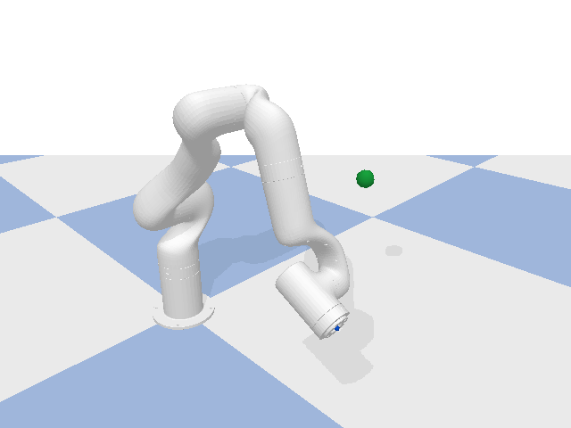
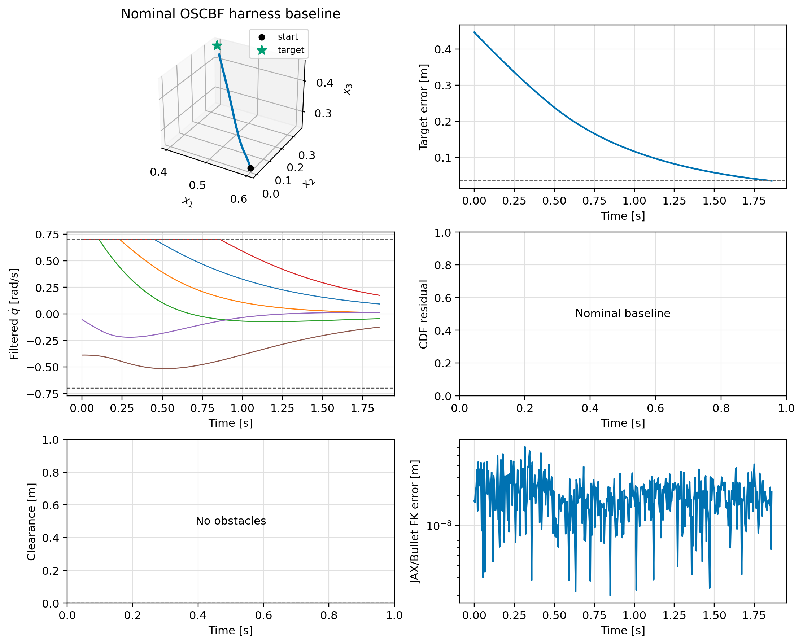
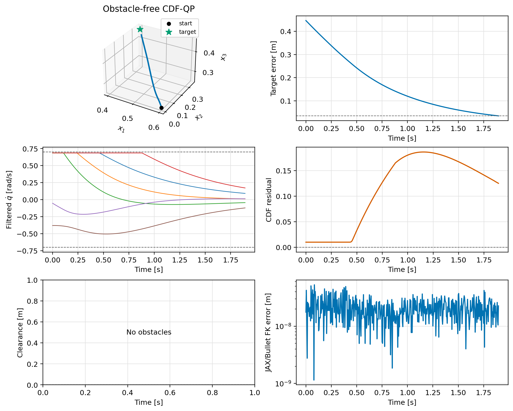
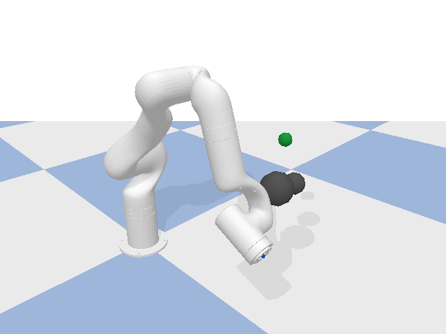
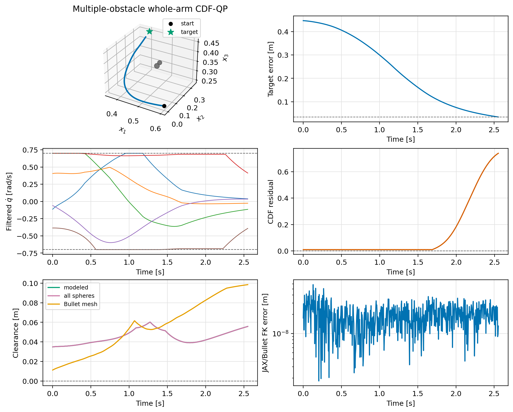
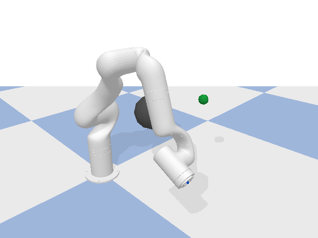
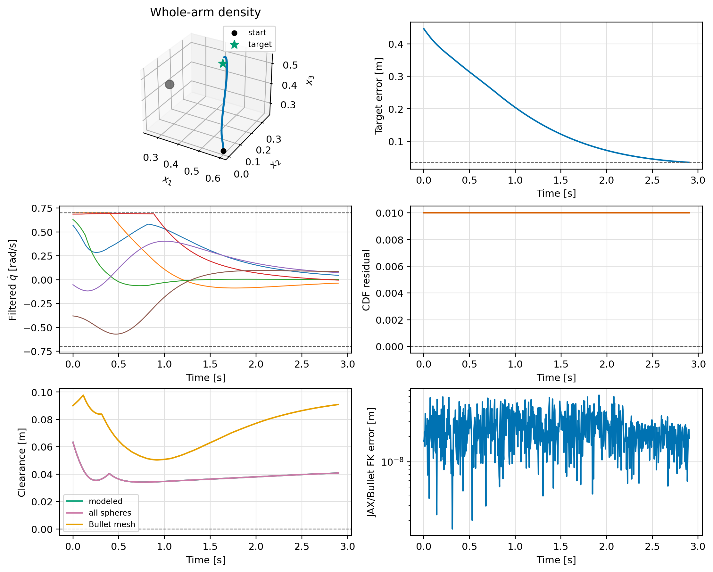
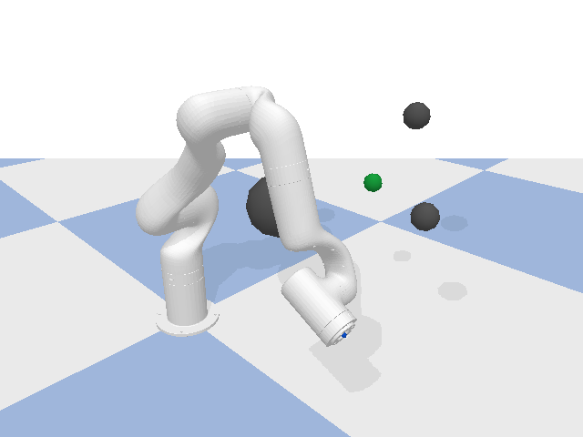
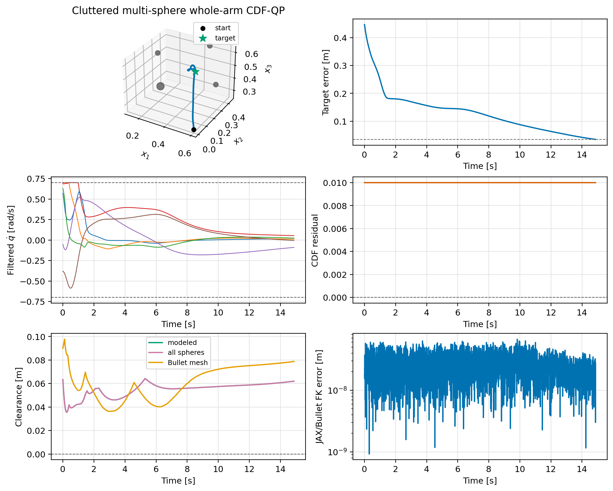

# UF850 CDF-QP PyBullet validations

These tests reuse the OSCBF UF850 PyBullet harness and nominal pose-task
controller. Only the safety-filter optimization is changed to the pointwise
CDF-QP where indicated. PyBullet is used for kinematic playback, rendering,
mesh clearance/contact checks, and an independent forward-kinematics check.

| ID | Validation | Reached | Min sphere clearance [m] | Min Bullet clearance [m] | Contact steps |
|---:|---|:---:|---:|---:|---:|
| [1](validation_01/README.md) | Nominal OSCBF harness baseline | True | None | None | 0 |
| [2](validation_02/README.md) | Obstacle-free CDF-QP | True | None | None | 0 |
| [3](validation_03/README.md) | Single-obstacle whole-arm CDF-QP | True | 0.026953104433531938 | 0.0026077739999621763 | 0 |
| [4](validation_04/README.md) | Multiple-obstacle whole-arm CDF-QP | True | 0.034831362451792074 | 0.011151410629092022 | 0 |
| [5](validation_05/README.md) | End-effector-only density counterexample | True | -0.035153319799761246 | -0.00616088061069546 | 96 |
| [6](validation_06/README.md) | Whole-arm density | True | 0.0341805996739102 | 0.050432385547675526 | 0 |
| [7](validation_07/README.md) | Cluttered multi-sphere whole-arm CDF-QP | True | 0.03558539282120392 | 0.036329645690564 | 0 |
| [8](validation_08/README.md) | Gripper-equipped cluttered whole-arm CDF-QP | True | 0.039680230299457775 | 0.0642288473432216 | 0 |
| [9](validation_09/README.md) | Closed-gripper TCP trajectory tracking in clutter | True | 0.020369575648533228 | 0.04854463049374312 | 0 |

## Validation 1

[Read the validation summary](validation_01/README.md) | [Detailed results](validation_01/results.md)

## Validation 2

[Read the validation summary](validation_02/README.md) | [Detailed results](validation_02/results.md)

## Validation 3

[Read the validation summary](validation_03/README.md) | [Detailed results](validation_03/results.md)

## Validation 4

[Read the validation summary](validation_04/README.md) | [Detailed results](validation_04/results.md)

## Validation 5

[Read the validation summary](validation_05/README.md) | [Detailed results](validation_05/results.md)

## Validation 6

[Read the validation summary](validation_06/README.md) | [Detailed results](validation_06/results.md)

## Validation 7

[Read the validation summary](validation_07/README.md) | [Detailed results](validation_07/results.md)

## Validation 8

[Read the validation summary](validation_08/README.md) | [Detailed results](validation_08/results.md)

## Validation 9

[Read the validation summary](validation_09/README.md) | [Detailed results](validation_09/results.md)

## Gripper status and remaining TODO

- Completed in validation 8: load the gripper-enabled UF850 URDF, hold all six
  gripper joints at a fixed `0.45 rad` opening, add six conservative palm and
  finger spheres to the JAX model, and check both sphere and Bullet mesh
  clearance in a three-obstacle cluttered scene.
- Completed in validation 9: track the URDF-defined `link_tcp` at a `0.172 m`
  wrist offset with the gripper closed at `0.85 rad`, preserve a fixed tool
  orientation, and filter a smooth Cartesian reference through denser clutter.
- Generalize the collision spheres to follow a commanded gripper opening
  instead of assuming one fixed configuration.
- Validate the gripper sphere cover against Bullet mesh distances over the
  full opening range.
- Include at least one narrow-passage case where safety depends on coordinated
  clearance of the upper arm, wrist, and gripper rather than only the end
  effector.
- Compare CDF-QP and OSCBF using identical starts, goals, obstacle fields,
  nominal controls, rate limits, timestep, and collision geometry.
- Report convergence, modeled and Bullet clearance, contacts, residuals,
  feasibility, input limits, solve time, plots, and PyBullet GIFs for every
  cluttered scene.
