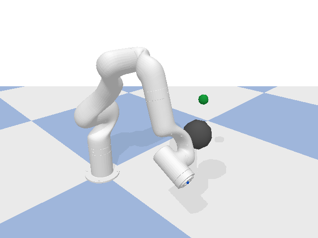
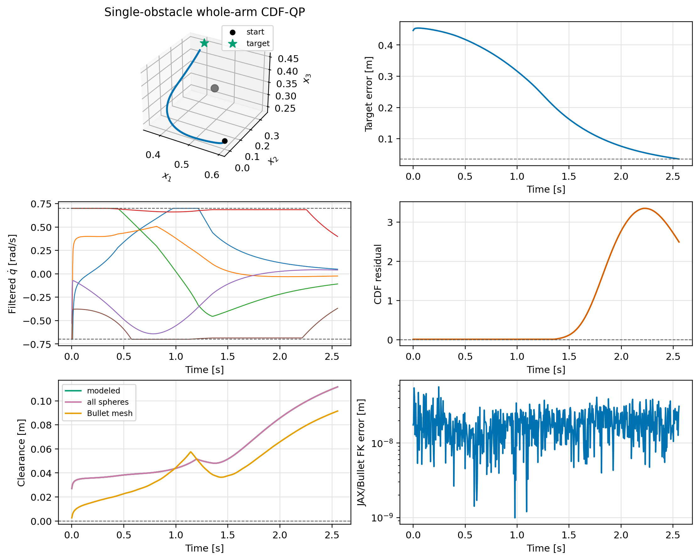

# Validation 3: Single-obstacle whole-arm CDF-QP

Avoid one sphere on the nominal workspace path using all link spheres.

## Setup

| Parameter | Value |
|---|---:|
| Timestep | `0.00416667 s` |
| Filter | `cdf` |
| Safety geometry | `whole_body` |
| Joint-rate limit | `0.7 rad/s` |
| Obstacles | `1` |

The runner matches the OSCBF playground: the pose-task controller produces
`u_nom`, the selected filter returns `qdot`, and the state is advanced with
`q_next = q + dt*qdot` before `resetJointState` and one `stepSimulation` call.

## Finding

The robot reached the target. Bullet reported contact on `0` steps, and all configured QPs were feasible: `True`.

Detailed metrics are listed in [results.md](results.md).
