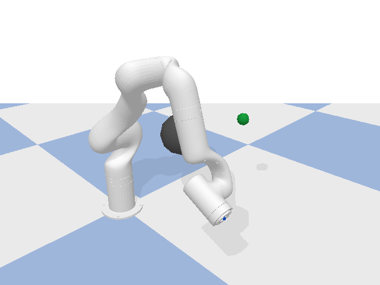
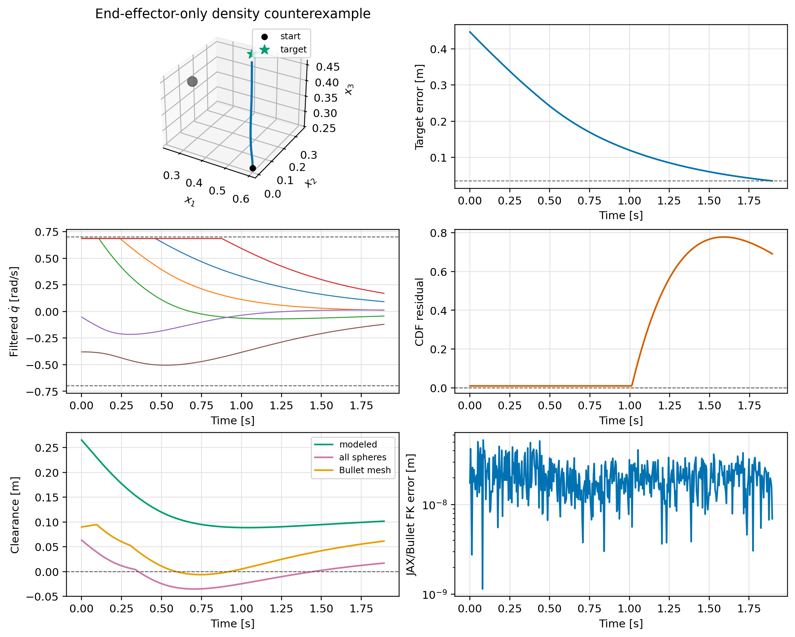

# Validation 5: End-effector-only density counterexample

Show that EE clearance does not imply clearance for intermediate links.

## Setup

| Parameter | Value |
|---|---:|
| Timestep | `0.00416667 s` |
| Filter | `cdf` |
| Safety geometry | `ee` |
| Joint-rate limit | `0.7 rad/s` |
| Obstacles | `1` |

The runner matches the OSCBF playground: the pose-task controller produces
`u_nom`, the selected filter returns `qdot`, and the state is advanced with
`q_next = q + dt*qdot` before `resetJointState` and one `stepSimulation` call.

## Finding

The robot reached the target. The end-effector-only filter left the remaining links unmodeled; the minimum all-sphere clearance was `-0.035153319799761246` m and Bullet reported contact on `96` steps.

Detailed metrics are listed in [results.md](results.md).
