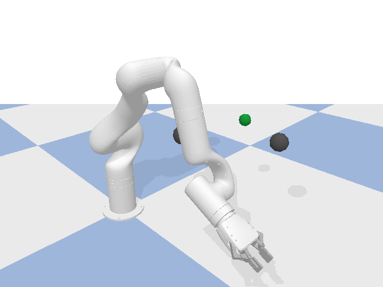
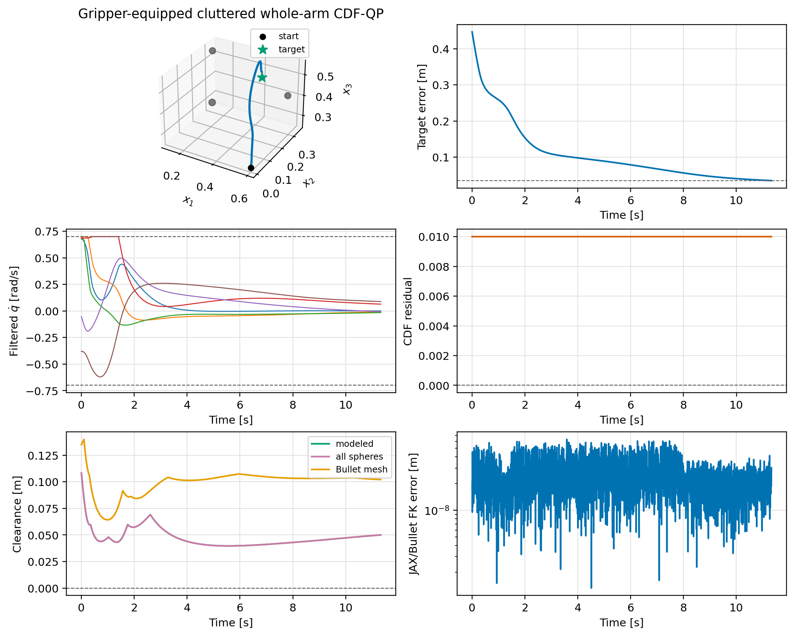

# Validation 8: Gripper-equipped cluttered whole-arm CDF-QP

Validate a collision-free path through a cluttered workspace with a fixed-open xArm gripper and gripper safety spheres.

## Setup

| Parameter | Value |
|---|---:|
| Timestep | `0.00416667 s` |
| Filter | `cdf` |
| Safety geometry | `whole_body` |
| Joint-rate limit | `0.7 rad/s` |
| Obstacles | `3` |
| Gripper enabled | `True` |
| Gripper opening | `0.45 rad` |

The runner matches the OSCBF playground: the pose-task controller produces
`u_nom`, the selected filter returns `qdot`, and the state is advanced with
`q_next = q + dt*qdot` before `resetJointState` and one `stepSimulation` call.

## Finding

The gripper-equipped whole-arm CDF-QP reached the target through a `3`-sphere clutter field sized for the larger gripper footprint. The minimum arm-and-gripper sphere clearance was `0.039680230299457775` m and Bullet reported contact on `0` steps.

Detailed metrics are listed in [results.md](results.md).
