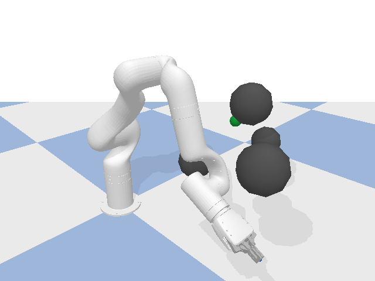
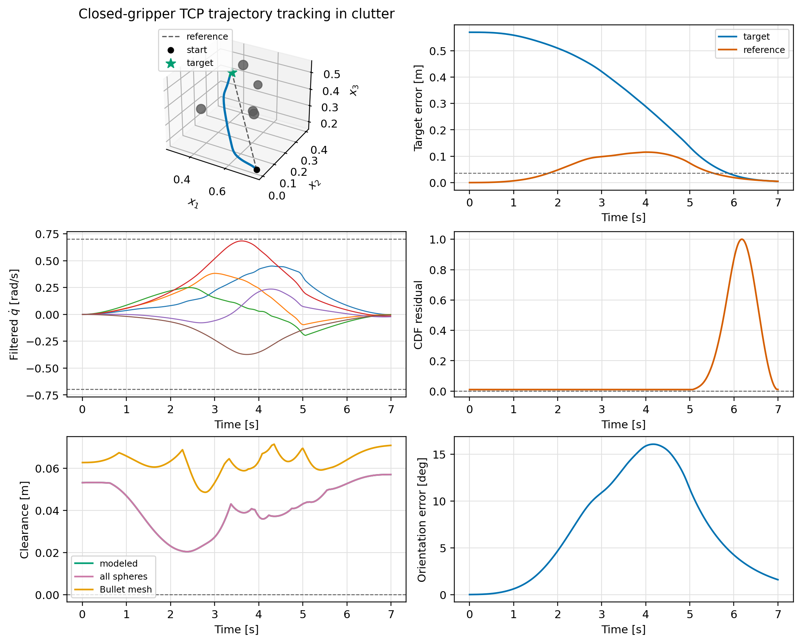

# Validation 9: Closed-gripper TCP trajectory tracking in clutter

Track a smooth Cartesian reference with the closed-gripper fingertip midpoint while the whole-arm CDF-QP avoids a dense field of larger spherical obstacles.

## Setup

| Parameter | Value |
|---|---:|
| Timestep | `0.00416667 s` |
| Filter | `cdf` |
| Safety geometry | `whole_body` |
| Joint-rate limit | `0.7 rad/s` |
| Obstacles | `5` |
| Gripper enabled | `True` |
| Gripper opening | `0.85 rad` |
| Tracked frame | `link_tcp` |
| TCP offset | `(0.0, 0.0, 0.172) m` |
| Reference duration | `7.0 s` |
| Orientation gain | `1.0` |

The runner matches the OSCBF playground: the pose-task controller produces
`u_nom`, the selected filter returns `qdot`, and the state is advanced with
`q_next = q + dt*qdot` before `resetJointState` and one `stepSimulation` call.

## Finding

The closed-gripper TCP CDF-QP reached the final pose after tracking a minimum-jerk Cartesian reference through a `5`-sphere clutter field. The minimum arm-and-gripper sphere clearance was `0.020369575648533228` m, the final orientation error was `1.587790894284352` deg, and Bullet reported contact on `0` steps.

Detailed metrics are listed in [results.md](results.md).
